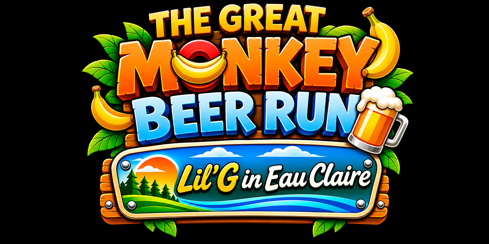

# Lil’ G in Eau Claire — working project

Future multiple-level side-scrolling runner and reskin of [Seth Happens](https://github.com/natsteff/seth-happens). Final game title is TBD. Reuse of its controls and configuration is planned; backdrop and level gameplay changes will be designed during integration.

## Imported resources

Imported from Great Monkey Beer Run on November 3, 2026.

- `assets/great-monkey-beer-run/monkey-phaser-skin/`: seven backdrops, a six-frame transparent Lil’ G sprite sheet, six individual frames, and the original handoff README, manifest, Phaser example, and Godot extraction helper.
- `docs/references/great-monkey-beer-run/title-logo-concept.jpg`: source title concept; the new title remains undecided.
- `docs/references/great-monkey-beer-run/beer-cargo/`: mixed beer stack and Unicorn Haze six-pack reference art. These are reference images, not prepared transparent gameplay sprites.
- `docs/references/great-monkey-beer-run/early-prototypes/`: three original concept boards covering characters/items/environments, Nana-Racer/GOAT vehicles, and Unicorn Garage locations and props. See the folder README for preparation notes.
- `docs/import-manifest.json`: SHA-256 hashes and sizes for all imported files.

The source pack is preserved unchanged, excluding Finder metadata. Its README documents animation registration, placement, and backdrop limitations. The extraction helper depends on the original Godot project; it is retained for provenance.

## Play the prototype

Run `python3 -m http.server 8000` from the repository root and open http://localhost:8000/. Use A/D or the arrow keys to move, Space to jump, F to interact, P to pause, and R to restart. Touch buttons provide movement, jump, and action.

Leave the apartment to the right, pick up the full beer stack in the garage, and cross three residential stretches on either side of Downtown. Collect the spring in Residential A1 to unlock Mega Jump. Press Jump twice quickly for extra height. Landing on top of moving traffic is safe. At the destination, use Action near the center marker to enter. Inside 3rd & Vine, use Action at the delivery marker by the bar to finish. Bumps are counted and briefly knock Lil’ G back.

This first playable uses the browser Canvas API and Seth Happens-style keyboard bindings. It has no external build dependencies. For future GitHub Pages hosting, serve the repository root. Asset links and the web app manifest use relative URLs.

## App icon and home-screen name

The provisional icon is saved at `assets/branding/app-icon-original.png`. The default home-screen label must be **Lil G in EC**. See `assets/branding/README.md` for web app integration requirements.

## Seth Happens technical handoff

The [technical handoff](https://github.com/natsteff/seth-happens/blob/main/MONKEY_BEER_RUN_HANDOFF.md) recommends starting from the public Seth Happens v1.0.12 source as an independent Phaser game. Reuse the menu, input, and audio systems. Before the first run, disable shared scores, give browser storage its own namespace, and apply this project's logo, icon, and **Lil G in EC** home-screen name.

The first playable slice can use the exported Lil’ G sheet and one backdrop, with one platform and one interaction. Build the new route and level transitions from there. Seth Happens has a single gameplay scene, so progression across levels needs its own implementation.
